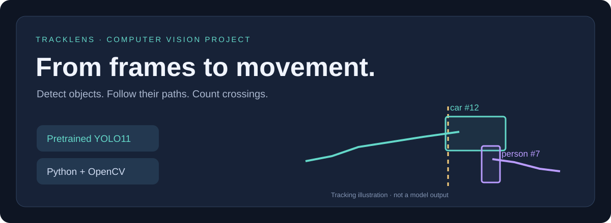

<div align="center">

# TrackLens
### My Object Tracking Dashboard

**From a video clip to object IDs, movement paths, and crossing counts.**

[Explore the demo](#see-it-in-action) · [Run locally](#run-it-on-your-computer) · [How it works](#under-the-hood) · [My learning notes](#what-im-learning)

</div>



> **By Adwaith Nambiar** · Python, pretrained YOLO11, OpenCV, SciPy, and Flask  
> A local computer vision prototype created with AI assistance.

## Why I chose this project

I'm interested in the intersection of machine learning, computer vision, and embedded systems. For this project, I wanted to explore what happens after a model detects an object: how do you follow it through a video, visualize its movement, and turn those observations into useful counts?

TrackLens connects pretrained object detection to a tracking pipeline and a browser dashboard. I set up the project on my Windows machine and published the source here. This repository documents the implementation, its tests, and the limitations I still need to work on.

## See it in action


*Actual output from the built-in synthetic demo. The two colored rectangles are tracked across frames. This demo uses color thresholds; it does not use YOLO.*

### Two ways to explore

| Mode | What you provide | What it demonstrates |
| --- | --- | --- |
| **Synthetic shapes demo** | Nothing—click the demo button | Tracking IDs, paths, crossing counts, and exports |
| **Pretrained YOLO detection** | A short video clip | Object detection connected to tracking and counting |

<details>
<summary><strong>What am I looking at in the preview?</strong></summary>

- **Bounding boxes** mark the detected objects.
- **Labels and IDs** show the category and current track identifier.
- **Trails** connect recent object-center positions.
- **The vertical line** is the crossing boundary.
- **The footer** shows the analyzed frame, visible confirmed tracks, and accumulated track IDs.

An ID belongs to a track in this clip. It does not identify a person, and it may change if the tracker loses the object.

</details>

## What the dashboard does

- Upload a video and choose which object classes to detect.
- Adjust confidence, frame sampling, and counting-line position.
- Watch the latest annotated frame update during processing.
- Inspect counts by category and crossing direction.
- Download annotated footage, track logs, crossing events, and a summary.

| Supported category | Example use |
| --- | --- |
| Person | Explore pedestrian movement |
| Bicycle / motorcycle | Follow two-wheeled traffic |
| Car / bus / truck | Visualize vehicle paths |
| Cat / dog | Experiment with animal movement |

The app processes video files in the background. It displays periodically refreshed images rather than streaming a webcam feed.

## Run it on your computer

### Windows CMD

Open a terminal **inside the folder containing `app.py`**. Run each command separately and stop if one fails.

```bat
git clone https://github.com/adwaithnambiar2/object-tracking-dashboard.git
cd object-tracking-dashboard
py -3.9 -m venv .venv
.venv\Scripts\activate
python -m pip install --upgrade pip
python -m pip install -r requirements.txt
python app.py
```

Open **http://127.0.0.1:5004** and keep the terminal open.

Python 3.9 is the version used for my Windows setup. You can substitute `py -3.11` if Python 3.11 is installed. Run `py -0p` to see your installed versions.

**First-install note:** PyTorch and the detector dependencies are large, so installation can take several minutes. The first YOLO job also downloads the model weights. The app explicitly uses CPU inference; a GPU is not required.

<details>
<summary><strong>macOS / Linux setup</strong></summary>

```bash
git clone https://github.com/adwaithnambiar2/object-tracking-dashboard.git
cd object-tracking-dashboard
python3 -m venv .venv
source .venv/bin/activate
python -m pip install --upgrade pip
python -m pip install -r requirements.txt
python app.py
```

Open http://127.0.0.1:5004. Press Ctrl+C to stop the server.

</details>

<details>
<summary><strong>Try the lightweight demo before installing YOLO</strong></summary>

After creating and activating the virtual environment:

```bat
python -m pip install -r requirements-demo.txt
python app.py
```

Click **Try synthetic shapes demo**. This verifies the dashboard and geometric tracking workflow without downloading model weights.

Install the full `requirements.txt` before using pretrained detection on uploaded clips.

</details>

## Your first experiment

1. Start the app and run **Try synthetic shapes demo**.
2. Check that the result contains two confirmed track IDs and two crossings.
3. Upload a short clip—start with 5–15 seconds.
4. Select the classes that appear in the clip.
5. Process it and download the annotated AVI and CSV logs.
6. Change the frame stride and compare paths and counts.

### Demo checklist

- [ ] Run the shapes demo.
- [ ] Try a real video with pretrained detection.
- [ ] Move the counting line and compare results.
- [ ] Compare stride 1 with stride 3.
- [ ] Inspect the crossing CSV.
- [ ] Find an example where a track ID switches.

*These are suggestions for your own experiment, not claims that every experiment has already been completed.*

## Under the hood

### Detection

The pretrained **YOLO11n** model returns object boxes, labels, and confidence scores. This project uses the model for inference; it does not train or fine-tune its weights.

### Tracking

A custom geometric tracker associates detections with existing tracks using:

- Object-class matching.
- Centroid distance with a simple motion prediction.
- Bounding-box intersection-over-union.
- Hungarian assignment for one-to-one matching.

Tracks are confirmed after three matched observations. Missing tracks remain eligible for matching for up to eight analyzed updates, and the last 50 center positions form the visible trail.

<details>
<summary><strong>Walk through one video frame</strong></summary>

1. OpenCV reads and resizes the frame.
2. The detector produces boxes for the selected categories.
3. The tracker predicts where existing tracks may have moved.
4. Matching assigns detections to tracks or creates new IDs.
5. Confirmed tracks update their paths and crossing state.
6. The app annotates the image and writes observations to CSV.
7. The dashboard polls the job endpoint for progress and results.

The tracker is a lightweight implementation, not ByteTrack or an appearance-based re-identification system.

</details>

### What the counts actually mean

| Dashboard value | Definition |
| --- | --- |
| Confirmed track IDs | Tracks with at least three matched observations |
| Visible tracks | Confirmed tracks detected on the current analyzed frame |
| Left → right | Confirmed tracks that cross from the left side of the line to the right |
| Right → left | Confirmed tracks that cross in the reverse direction |

A small dead zone helps suppress crossings caused by jitter around the line. Each track can count once per direction. Crossings before confirmation may be missed.

**A track count is an estimate, not a guaranteed count of distinct physical objects.** An object that disappears and later gets a new ID can be counted again.

## Downloads and project files

| Export | What it contains |
| --- | --- |
| `annotated.avi` | Boxes, IDs, movement trails, and the counting line |
| `tracks.csv` | Frame, timestamp, track ID, category, score, and box coordinates |
| `crossings.csv` | Frame, ID, category, and crossing direction |
| `summary.json` | Counts, processing time, frame sampling, and metadata |
| `preview.jpg` | Latest annotated frame |

Results and uploaded clips stay in `runs/<job-id>/`. The source files and weights are excluded from Git. Download the AVI to watch it in a compatible local player; browser AVI playback is not guaranteed.

<details>
<summary><strong>Explore the source code</strong></summary>

| File | Responsibility |
| --- | --- |
| `app.py` | Dashboard routes, uploads, jobs, and downloads |
| `detectors.py` | YOLO inference and synthetic demo detector |
| `tracker.py` | Matching, track lifecycle, paths, and counts |
| `video.py` | Decode, annotate, and export video |
| `cli.py` | Process a clip from the command line |
| `templates/index.html` | Dashboard layout and progress polling |
| `tests/` | Tracking and integration tests |
| `reports/verification.json` | Recorded verification scope |
| `.github/workflows/tests.yml` | Automated lightweight tests |
| `start_windows.bat` | Launch helper after setup |

</details>

## Testing and verification

```bat
python -m unittest discover -s tests -v
```

**12 automated tests passed** during project verification. They cover ID association, class gating, confirmation, expiry, short occlusions, crossing behavior, exports, asynchronous jobs, and invalid inputs.

| Check | Recorded result |
| --- | --- |
| Synthetic moving-shapes clip | Two tracks and two directional crossings |
| Pretrained inference smoke test | People and a bus detected in a repeated-image test clip |
| HTTP job and download endpoints | Passed |
| Frontend JavaScript syntax | Passed |

See the [verification report](reports/verification.json) and the repository's [Actions tab](https://github.com/adwaithnambiar2/object-tracking-dashboard/actions).

The real-image check verifies that inference and exports execute. It is **not a tracking-accuracy benchmark on real moving video**. No IDF1, HOTA, or real-video count-accuracy result is claimed.

<details>
<summary><strong>Run without the browser</strong></summary>

Synthetic demo:

```bat
python cli.py --demo --output runs/demo
```

Local video:

```bat
python cli.py --source "C:\path\to\clip.mp4" --classes person car --stride 2 --output runs/my-clip
```

Choose a new output folder to preserve earlier results. CLI runs replace result files in the selected folder.

</details>

## What I'm learning

This project gives me a practical way to explore:

- **Detection versus tracking:** finding objects in one frame differs from maintaining their IDs over time.
- **Sampling tradeoffs:** analyzing fewer frames saves work but can miss movement.
- **Counting logic:** noisy detections and ID fragmentation affect reported totals.
- **Integration:** model inference, video handling, background jobs, and a web interface must work together.
- **Validation:** a passing demo is useful evidence of execution, but real-world reliability requires labeled evaluation.

### My next steps

- [ ] Test more varied real videos.
- [ ] Measure ID switches and count errors against manual labels.
- [ ] Compare the custom tracker with an established tracking approach.
- [ ] Improve behavior during occlusion and camera movement.
- [ ] Add configurable counting regions.

## AI assistance

I used **ChatGPT for the initial implementation, debugging support, testing guidance, setup troubleshooting, and documentation**. I used the assistance to get the project running locally and publish it on GitHub.

The pretrained detector comes from Ultralytics. I am presenting this as an **AI-assisted learning project**, with the implementation and verification details available for review.

## Limits worth understanding

The tracker can lose IDs in crowded scenes, during prolonged occlusion, or when similar objects cross paths. Confidence scores are not calibrated probabilities. The system processes one clip at a time, accepts uploads up to 100 MB, and limits clips to 18,000 decoded frames.

Frames are resized to fit within 960×720. The annotated AVI uses source FPS divided by stride to approximately preserve clip duration. Restarting the app clears its in-memory job list; interrupted jobs do not resume automatically. Files remain on disk.

This is a local development application, without production hosting, authentication, or a real-video benchmark.

<details>
<summary><strong>Having trouble?</strong></summary>

| Symptom | Check |
| --- | --- |
| Connection refused | Run `python app.py`, leave CMD open, and use port 5004 |
| Python version missing | Run `py -0p` and select an installed supported version |
| Import error | Activate `.venv` and install requirements |
| Model download fails | Check internet access; try the synthetic demo meanwhile |
| Video will not decode | Try a short standard MP4 or AVI |
| Processing feels slow | Use a shorter clip or increase stride |
| IDs switch | Inspect occlusion, detector misses, and fast motion |
| AVI will not play online | Download and open in a compatible local player |

</details>

## About me

**Adwaith Nambiar**  
Interested in machine learning, computer vision, embedded systems, and the connection between hardware and software.

[GitHub profile](https://github.com/adwaithnambiar2) · [AI Ticket Router](https://github.com/adwaithnambiar2/ai-ticket-router) · [KNN Music Recommender](https://github.com/adwaithnambiar2/knn-music-recommender)

## References and licensing

- [Ultralytics YOLO11](https://docs.ultralytics.com/models/yolo11/)
- [Ultralytics prediction documentation](https://docs.ultralytics.com/modes/predict/)
- [OpenCV](https://opencv.org/)
- [SciPy](https://scipy.org/)

Original project source is provided under the [MIT License](LICENSE). Ultralytics software and model weights retain their own [licensing terms](https://www.ultralytics.com/license), and other dependencies retain their respective licenses.

---

<div align="center">

**Try a clip, inspect the paths, and compare the counts with what you see.**

</div>
