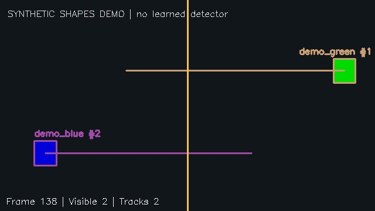

# TrackLens — Object Tracking Dashboard

**Detect objects. Follow paths. Count movement.**

A local computer vision project by **Adwaith Nambiar**, created with substantial ChatGPT assistance. Upload a video to detect selected objects with pretrained YOLO11n, associate detections across frames, display paths, and export annotated footage and CSV logs.

**Python · YOLO11 · OpenCV · SciPy · Flask · HTML/CSS/JavaScript**

## What you can do

- Upload MP4, AVI, MOV, or MKV clips, up to 100 MB.
- Select people, bicycles, cars, motorcycles, buses, trucks, cats, or dogs.
- Adjust detector confidence, frame sampling, and the vertical counting line.
- View a periodically updated annotated frame with bounding boxes, IDs, and paths.
- See confirmed track counts and crossings in each direction.
- Download an annotated AVI, frame-level track CSV, crossing CSV, and JSON summary.
- Run a synthetic shapes demo without model weights.

The app processes uploaded clips in the background; it is not a webcam stream. The preview refreshes while processing, and the annotated video is downloaded separately. AVI playback may require a local player such as VLC.

## Tracking preview



*Generated shapes demo: verifies geometric tracking and counting, not learned detection.*

## Quick start — Windows CMD

Open CMD inside this extracted project folder. Python 3.9 can be used on your current machine; Python 3.11 is a good choice for a fresh environment. Keep this environment separate from your other projects.

```bat
py -3.9 -m venv .venv
.venv\Scripts\activate
python -m pip install --upgrade pip
python -m pip install -r requirements.txt
python -m unittest discover -s tests -v
python app.py
```

Substitute `py -3.11` if that is your installed version. Installing PyTorch and the detector can take several minutes and use substantial disk space. No NVIDIA GPU is required: the app explicitly runs inference on CPU.

Open **http://127.0.0.1:5004**. Keep CMD open. Stop the server with **Ctrl+C**.

### Try it first

1. Click **Try synthetic shapes demo** to check the dashboard and tracking workflow.
2. Upload a short clip of people or vehicles.
3. Select the matching object classes and click **Track uploaded video**.
4. Wait for completion, then download the results.

The first YOLO run downloads `weights/yolo11n.pt`. Internet access is required for that download. Later runs can reuse the weights. Failure to download the model is shown as a job error.

### Lightweight demo setup

To try the dashboard before installing the learned detector, use:

```bat
python -m pip install -r requirements-demo.txt
python app.py
```

Then select the synthetic demo. This mode detects known colored rectangles using HSV thresholds. **It does not use machine learning and does not validate YOLO detection accuracy.** Install the full requirements for uploaded-video detection.

### macOS / Linux

```bash
python3 -m venv .venv
source .venv/bin/activate
python -m pip install --upgrade pip
python -m pip install -r requirements.txt
python app.py
```

## Detection and tracking

### Pretrained detection

YOLO11n produces object labels, confidence scores, and bounding boxes. The project uses these weights for inference; it does not train or fine-tune the detector. See the [official prediction documentation](https://docs.ultralytics.com/modes/predict/) and [YOLO11 documentation](https://docs.ultralytics.com/models/yolo11/).

### Custom tracking

`tracker.py` uses a class-gated Hungarian assignment:

1. Predict each existing track's centroid from its previous motion.
2. Compute matching costs using centroid distance and box intersection-over-union.
3. Reject class mismatches and candidates beyond the distance gate.
4. Associate detections one-to-one, or start a new track.
5. Keep unmatched tracks for up to eight analyzed updates to allow short occlusions.
6. Confirm a track after three matched observations and retain its last 50 path points.

This is a lightweight geometric tracker, not a re-identification model or ByteTrack implementation. It does not recognize faces or establish someone's identity.

## What the counts mean

| Metric | Definition |
| --- | --- |
| Confirmed track IDs | IDs with at least three matched observations, grouped by object class |
| Visible tracks | Confirmed tracks detected on the current analyzed frame |
| Left-to-right crossing | A confirmed track moves from the left side to the right side of the vertical line |
| Right-to-left crossing | A confirmed track moves in the reverse direction |

Crossing detection uses a small dead zone around the line to reduce jitter. Each track can contribute at most one crossing per direction. Crossings before confirmation may be missed. A track that leaves and returns after expiry gets a new ID and can be counted again. **Track counts are estimates, not guaranteed counts of distinct physical objects.**

## Processing and exports

The app resizes frames to fit within 960×720 while preserving aspect ratio. It analyzes every Nth frame (default: 2); increasing N reduces work but can lose fast movements and crossings. The output AVI plays analyzed frames at source FPS divided by N to approximately preserve clip duration.

| Output | Contents |
| --- | --- |
| `annotated.avi` | Bounding boxes, class labels, track IDs, paths, and counting line |
| `preview.jpg` | Latest annotated frame |
| `tracks.csv` | Source frame number, timestamp, ID, class, score, and bounding box |
| `crossings.csv` | Source frame, ID, class, and crossing direction |
| `summary.json` | Counts, processing time, frame sampling, and metadata |

Files remain in `runs/<job-id>/`. The app processes one video at a time and limits a session to 20 jobs and a clip to 18,000 decoded frames. Restarting the app clears the in-memory job list but keeps files on disk. Old runs can be deleted when no job is processing. A interrupted job does not resume automatically.

## Verification

```bat
python -m unittest discover -s tests -v
python cli.py --demo --output runs/demo
```

The 12 automated tests cover matching, confirmation, class gating, short occlusions, expiry, crossing jitter, distance rejection, video exports, asynchronous jobs, and input validation. They run without YOLO weights.

The synthetic clip has two known moving rectangles. Verification confirmed **two track IDs and two directional crossings** over 70 analyzed frames. A separate real-image smoke test used a short repeated-image clip from Ultralytics' public bus example and confirmed that pretrained inference, track creation, and video exports run successfully. This verifies execution, **not detection or tracking accuracy on a labeled real video**.

See `reports/verification.json` for the recorded scope. GitHub Actions is configured to run the lightweight automated tests on pushes and pull requests; this file does not claim the workflow has already run on your GitHub account.

## Command line

```bat
python cli.py --source "C:\path\to\clip.mp4" --classes person car --stride 2 --output runs/my-clip
```

Results are written to the output folder. Each CLI run replaces result files in that folder; choose a different folder to keep earlier results.

## Project files

| File | Purpose |
| --- | --- |
| `app.py` | Flask dashboard, upload validation, background jobs, and downloads |
| `detectors.py` | Pretrained YOLO adapter and clearly separated synthetic detector |
| `tracker.py` | Association, track state, confirmation, and counting |
| `video.py` | Video decoding, annotation, processing, and export |
| `cli.py` | Video processing without the browser |
| `templates/index.html` | Responsive dashboard and progress polling |
| `tests/` | Tracking and integration tests |
| `reports/verification.json` | Recorded validation and its limits |
| `.github/workflows/tests.yml` | Lightweight test automation |
| `start_windows.bat` | Launch helper after environment setup |

## Troubleshooting

| Problem | Next step |
| --- | --- |
| Browser refuses connection | Run `python app.py` and keep CMD open; use port 5004 |
| Python version unavailable | Run `py -0p` and use an installed supported version |
| Package missing | Activate `.venv` and install full requirements |
| Model download fails | Check internet access and retry; the shapes demo works without weights |
| Video cannot be decoded | Try a short standard MP4 or AVI; codec support depends on OpenCV |
| Processing takes time | Start with a 5–15 second clip, use fewer classes, or increase frame stride |
| IDs change or counts look wrong | Occlusion, camera movement, similar objects, and frame skipping can break association |
| Annotated AVI will not play in browser | Download it and open it with a compatible video player |

## Limitations and next steps

Dense crowds, crossing trajectories, camera movement, prolonged occlusion, and detector misses can cause ID switches or duplicate counts. Detector scores are not calibrated probabilities. There is no real-world accuracy benchmark in this project. It is a local development application, without authentication or production deployment.

Next steps include labeled-video evaluation with IDF1/HOTA metrics, comparison against an established tracker, better motion estimation, configurable regions of interest, and validated count accuracy.

## Upload to GitHub

Create an empty repository named **object-tracking-dashboard** under **adwaithnambiar2** at https://github.com/new. Leave GitHub's README, license, and gitignore initialization options unchecked.

Inside this project folder:

```bat
git init
git add .
git status --short
git commit -m "Add object tracking dashboard"
git branch -M main
git config --local credential.username adwaithnambiar2
git remote add origin https://adwaithnambiar2@github.com/adwaithnambiar2/object-tracking-dashboard.git
git push -u origin main
```

Before committing, confirm that `.venv`, model weights, input videos, and `runs` are excluded. The source code, tests, and verification report should be included.

## Attribution and licensing

Created with substantial ChatGPT assistance for code, documentation, and the synthetic demo. Original project source is provided under the MIT license in `LICENSE`. Ultralytics software and model weights retain their own [licensing terms](https://www.ultralytics.com/license); they are not covered by this project's MIT license and are not bundled here. OpenCV, SciPy, and other dependencies retain their respective licenses.

This project supports an accurate description of **pretrained object-detection inference, geometric tracking, video processing, and local web-app integration** after you run and understand it. It does not establish experience training a detector, using ROS, using Isaac Sim, or performing multi-GPU training.
